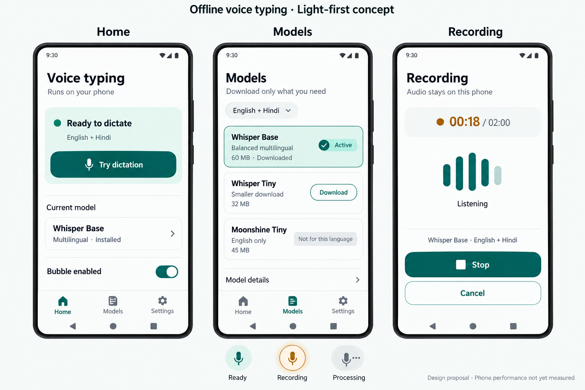

# Android voice typing — design specification

Implementation update 0.1.3 (2026-10-26): input-field recording now uses a compact visible start handoff followed by floating Stop/Cancel controls over the editor. Settings uses a topic list with focused subpages. History details occupy a full page with audio playback and vertically aligned actions. These behavior updates supersede the earlier persistent recording-dialog/history-dialog descriptions below. See `docs/PATCH_0.1.3.md`; on-device visual acceptance is still pending.

Version 1, 2026-10-25. **Light mode is the user-confirmed primary theme.** The composition, tokens and concept below are proposed design decisions for review, not an implemented or device-tested Android interface. No public product name or logo has been chosen.

This is an AI-generated visual concept, not a screenshot of a running app. It establishes hierarchy and color direction, not pixel-accurate controls, native behavior or measured performance. Written contracts/tokens below govern implementation when the image differs. In particular, use flat semantic fills rather than the image's incidental glossy shading; use the native Material navigation icon set; keep every touch target ≥48 dp.

## Authority and reading order

- [PRODUCT.md](PRODUCT.md): durable product truth and the confirmed light-first preference.
- This file: proposed visual system and cross-screen rules; supersedes the earlier dark-primary styling paragraph in the planning spec.
- [Screen specification](docs/design/SCREEN_SPEC.md): flows, copy, states, adaptation and component behavior.
- [Reference study](docs/design/REFERENCE_STUDY.md): observed source designs, visual assets, dates, take/adapt/avoid decisions and evidence limitations.
- [Model selection](docs/planning/MODEL_SELECTION.md): what users will actually be able to select and why Handy's whole catalog is not the initial phone catalog.
- [Engineering architecture](docs/planning/SYSTEM_ARCHITECTURE.md) and [permissions/policies](docs/planning/ANDROID_PERMISSIONS_AND_POLICIES.md): OS/privacy truth overrides visual shorthand.

Do not treat reference-site copy, model claims, screenshots or typography as an instruction to copy the competitor or as evidence of our product capabilities. Screenshots are study material. The supplied Handy image establishes a model-library reference, not permission to reproduce its branding or its benchmark meters.

## Design direction: a quiet native writing utility

The distinctive mechanism is a small contextual mic that hands off to clearly visible local recording, then safely returns final text to the original editor. The app's Home is a readiness/workflow surface; Models is a tool library organized around language and storage; Recording is a focused instrument with one decisive Stop action.

Use near-white mineral surfaces, dark slate text and a restrained deep-teal action color. Amber means active capture or caution, never a generic brand decoration. Build visual identity through the paired speech-level bars and stable text baseline in our own icon/illustration work; do not reuse Wispr's waveform logo or looping lavender ribbon. Illustrations, if needed, explain permission or model flows and never substitute for actual controls.

Use native Material 3 components and behavior. The consumer should immediately understand how to go Back, switch settings and stop recording. Brand expression lives in semantic color, spacious readable text and a clear active model, rather than proprietary switches, huge marketing headlines or custom navigation.

## Proposed semantic color tokens

These are **our proposed tokens**, not measured Wispr/Willow tokens. Implement through Material role names; never scatter raw hex through components. Honor user-selected theme; default to light for the first-run design while offering Light / Dark / System. Wallpaper-based Dynamic Color may be an optional later setting; fixed semantic capture/error meanings must survive it.

| Role | Light primary | Dark companion | Use |
|---|---|---|---|
| background / surface | `#F7FAF9` | `#101916` | Main canvas |
| surfaceContainerLow | `#FFFFFF` | `#18231F` | Owned sheets/content surfaces |
| surfaceContainer | `#EEF4F1` | `#213029` | Secondary regions, group backgrounds |
| onSurface | `#182724` | `#E4EFE9` | Primary text |
| onSurfaceVariant | `#4B605B` | `#B2C7BE` | Supporting text |
| primary | `#006B5D` | `#82D8C0` | Main action, selection |
| onPrimary | `#FFFFFF` | `#00382D` | Main-action text/icons |
| primaryContainer | `#D8EFE8` | `#174E41` | Active-model/readiness grouping |
| onPrimaryContainer | `#07382F` | `#B9F2DF` | Active/readiness content |
| outline | `#697F77` | `#81978D` | Necessary field/control boundary |
| outlineVariant | `#D4DFD9` | `#3B4C43` | Nonessential separators, not sole focus indication |
| recording / warning | `#8A5100` | `#FFCE86` | Timer/dot/recording label |
| recordingContainer | `#FFF0D2` | `#4F350F` | Capture-status background |
| error | `#B3261E` | `#FFB4AB` | Actionable failure |
| onError | `#FFFFFF` | `#690005` | Filled error action if needed |

Use an icon/word alongside color for recording, failure, active model and incompatible language. Disabled components use Material disabled-state opacity and a visible reason; never encode a critical state through a faint label alone. Focus indication uses a contrasting 2 dp role-based outline, not the low-contrast divider token. Check actual computed rendering and all state combinations on device; the text-color-pair audit in `work/design-research/design-validation.json` is only a static token check.

## Typography and bilingual text

Use Android's system sans-serif through Material typography. Roboto for Latin where supplied by the OS, with native Noto/Devanagari fallback. Do not bundle Wispr's marketing serif or Willow's commercial font. Preserve system font scaling and fallback shaping; no manual per-character letter spacing in Hindi.

| Material role | Proposed size / line height / weight | Placement |
|---|---|---|
| headlineMedium | 28 / 36 sp, 600 | Primary screen title |
| titleLarge | 22 / 28 sp, 500 | Recording status or important sheet title |
| titleMedium | 16 / 24 sp, 600 | Model name / section heading |
| bodyLarge | 16 / 26 sp, 400 | Main explanation / bilingual transcript |
| bodyMedium | 14 / 22 sp, 400 | Supporting information |
| labelLarge | 14 / 20 sp, 600 | Button/chip labels |
| labelMedium | 12 / 18 sp, 500 | Noncritical metadata, never primary actions |

Avoid forced uppercase, tiny hardware labels and condensed text in the consumer UI. Keep one main idea per paragraph. Transcript text can wrap freely; model names can wrap to two lines, with full name in details and accessible label. Examples for layout testing: `कल 3 बजे project update भेज देना।`, Indian names, long English file/model names, and emoji. These are design fixtures, not transcription results.

## Layout and geometry

- 4 dp foundational scale; common spacing 4/8/12/16/20/24/32. Compact screen padding 20 dp; use 16 dp on narrow windows where needed without clipping text.
- Native 56/64 dp app bars according to chosen Material component. Respect status/navigation/IME/cutout insets and edge-to-edge behavior.
- 48×48 dp minimum interactive region, at least 8 dp between separate targets; icon drawings typically 24 dp. Floating mic is 56 dp, draggable inside safe bounds.
- Radius: 8 dp small status groups, 12–16 dp model emphasis containers, Material native button/pill shapes, 28 dp recording sheet/activity surface where appropriate. No universal oversized radius on every row.
- Ordinary settings use grouped native rows/dividers; only readiness and the active model deserve stronger grouping. Available models form a calm list, not a wall of equally prominent recommended cards.
- Use tonal elevation and native overlay elevation; no arbitrary heavy shadow stack, frosted glass, decorative gradients or blurred content under recording controls.
- Compact width: Home / Models / Settings navigation bar. Medium/expanded: navigation rail; model list/detail can use two panes. Recording is a centered owned activity surface with bounded width, not an oversized tablet phone screen.

## Component vocabulary

| Component | Contract |
|---|---|
| Readiness panel | One status sentence and next useful action; green/teal accent only when all needed capabilities are ready |
| Primary button | Filled Material; one primary action per surface; label names action, not “Continue” when a specific action is available |
| Model row | Friendly model name, relevant languages, download bytes/state and one primary action; details progressively disclose artifact information |
| Active-model panel | Teal-tinted container, check + Active text; an installed model is not automatically active |
| Language filter chip | English / Hindi / English + Hindi; never lets an English-only engine silently satisfy mixed mode |
| Recording indicator | Word + elapsed/max timer + microphone/stop state; live levels only after real samples; zero mic activity during loading/processing |
| Download row | Exact progress, transferred/total bytes, Pause/Cancel; distinguish verification from completion |
| Error panel | Concrete cause and one recovery action; preserve a transcript when safe rather than replacing it with an empty screen |
| Copy fallback | Visible owned result surface, final text, Copy / Discard and expiry explanation; explicit copy only |

For every interactive component specify default, focused, pressed, disabled/reason, busy and error states. Hover may exist for mouse/tablet, never as the only affordance. Use native switches, chips, progress indicators, snackbars and dialogs. Destructive model/history deletion uses clear confirmation when the current/default model or retained transcripts would be lost.

## Bubble and recording states

| State | Appearance | User action and truth |
|---|---|---|
| Ready | Teal microphone on pale mint, accessible label “Start dictation” | Tap opens visible RecordingActivity; no capture yet |
| Loading | Progress + “Loading model” in owned surface | Cancel available; no animated live meter or Recording label |
| Recording | Amber dot/ring + timer + Stop icon/label | Stop and Cancel always available; microphone FGS notification active |
| Processing | Neutral/teal progress + “Transcribing on your phone” | Mic already released; Cancel; no moving speech-reactive waveform |
| Inserted | Brief check + “Text inserted” only after verified success | Do not send message/form |
| Copy needed | Clear “Copy your text” result surface | Copy/Discard; uncertain insertion has a distinct duplication warning |
| Permission missing | Appropriate icon + repair action in owned UI | Never start recording or repeatedly open system Settings |

The bubble is nonfocusable and does not intercept a full-screen transparent area. Drag and tap are distinct. Remember normalized position and re-clamp after keyboard/rotation changes. Hide on lock, unsupported/sensitive fields, excluded apps and system permission UI. Eligibility is not universally knowable; don't imply comprehensive screen-security detection. Idle overlay lifecycle is tied to the enabled accessibility service, not an always-on microphone service.

Tap-first is the dependable MVP. Hold-to-talk belongs inside the recording UI initially; direct overlay hold-to-talk is a later verified interaction because launching an activity can break the pointer sequence. The concept image must never be used to claim that a pure overlay can legally start microphone capture on every Android version.

## Motion, accessibility and privacy-visible design

- 150–250 ms native state transitions; no promotional entrance choreography. Honor Remove animations, replacing waveform/indeterminate motion with static state/timer where needed.
- Level bars show actual RMS/peak feedback, throttled to avoid excess work. Do not animate idle mic or imply listening during model load.
- Text contrast ≥4.5:1 for ordinary text; large text ≥3:1; essential controls/focus/state graphics ≥3:1. Check 200% font scaling, TalkBack order, contrast settings and switch/chip semantics.
- State announcements occur on meaningful transitions, not each waveform update/timer tick. Stop/Cancel labels remain visible without relying on icon familiarity.
- Language, model choice and privacy promise remain readable without opening advanced panels. “Offline ready” appears only when required model files are verified and installed.
- No transcript in notifications or diagnostic previews. History is off by default; enabling text history is separate from model/onboarding consent.

## What the references contributed

Wispr: contextual control, guided setup and explicit recording/cancel/confirm grouping. Handy: downloaded versus available models and active selection. Willow: spacious light hierarchy and short action-focused explanations. Superwhisper: compact active controls and advanced choices behind deliberate entry points. FUTO: communicate local processing plainly. Android Material: structure, controls and accessibility baseline.

Do not import competitor claims about speed, accuracy, rewriting, universal insertion or platform availability. Marketing-site tokens are not native-app tokens. See the [attributed visual study](docs/design/REFERENCE_STUDY.md) for evidence and limitations.

## Handoff and review gates

The board is one proposed coherent light-first interpretation, not a user-approved final UI. Before implementation, confirm the composition and visible recording activity. Before release, replace every conceptual performance state with actual measured eligibility, exercise native device screenshots in both themes/font scales, and run the full insertion/privacy/lifecycle test plan. Preserve the reviewed model/device rules even if a more attractive model catalog screenshot suggests otherwise.
