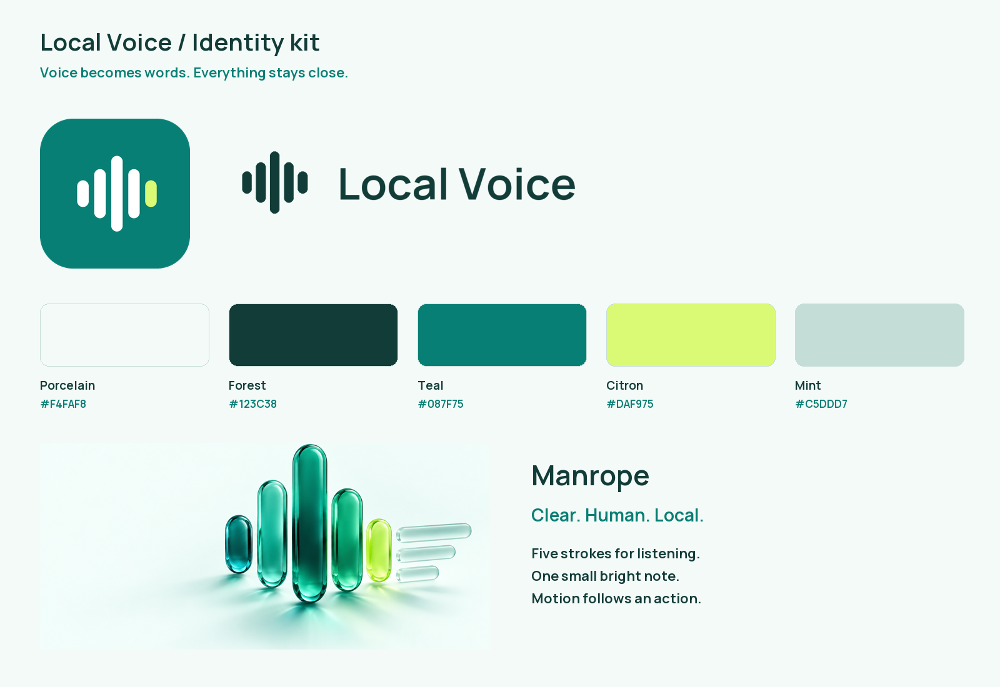

# Local Voice identity kit

Created 26 October 2026 for the local Android app and a future website. This is an asset handoff, not a website implementation.

## Files and intended use

| Folder / file | Use |
|---|---|
| `logos/mark-{teal,ink,white}.svg` | Original five-stroke symbol, transparent vector |
| `logos/wordmark-{teal,ink,white}.{svg,png}` | Horizontal lockups; SVG letters are paths, requiring no font at runtime |
| `icons/app-icon.svg` | Editable square app identity source |
| `icons/app-icon-{32,48,180,192,512,1024}.png` | Favicons, touch icons, app/store artwork |
| `icons/favicon.{svg,ico}` | Future website browser icon |
| `illustrations/voice-material.png` | Full-size generated decorative hero master (1536 × 1024) |
| `illustrations/voice-material.webp` | Compressed full-size web delivery version |
| `illustrations/voice-material-mobile.webp` | 960 × 640 web delivery version |
| `illustrations/speech-to-text.svg` | Original explanatory diagram: speech becomes text |
| `illustrations/local-processing.svg` | Original explanatory diagram: on-device processing |
| `illustrations/listening-wave.svg` | Static waveform fallback |
| `motion/listening-loop.svg` | Animated vector with reduced-motion media query |
| `motion/listening-loop.webp` | 24-frame, 1.2-second illustrative loop; use static fallback when motion is reduced |
| `social/open-graph.png` | 1200 × 630 sharing graphic |
| `social/feature-graphic.png` | 1024 × 500 feature graphic; no store publication implied |
| `fonts/Manrope.ttf`, `fonts/Manrope.woff2` | Self-hostable variable font, weights 200–800 |
| `fonts/OFL-Manrope.txt` | Font license; retain when redistributing fonts |
| `tokens.json` | Color, typography, space, radius and motion handoff |
| `previews/` | Identity and layout/reference boards for review |
| `references/` | Attributed third-party visual research, **not production assets** |
| `manifest.json` | Dimensions, byte sizes and checksums for handoff integrity |

Android sources under `app/src/main/res/` include adaptive/round icons, Android 13 monochrome icons and five legacy density exports. The app icon changes; functional mic/notification icons stay recognizable monochrome mic controls. Marketing imagery and fonts are not bundled into the APK.

## Identity rules

The symbol is five rounded vertical strokes: short, medium, tall, medium, short. It connects the app's listening dots with organized text rhythm. Use the citron final stroke only against teal/dark backgrounds. At small sizes use the symbol alone; do not add a tiny wordmark.

Keep one stroke-width of clear space around the symbol and half the symbol height around the lockup. Minimum recommended mark size: 24 px; minimum horizontal lockup width: 150 px. Preserve aspect ratio. Use teal/ink on light surfaces and white on forest/teal surfaces. Citron is decorative or a background for forest text, never body text on white. Do not add shadows or glass effects to the functional logo; the generated hero artwork provides the dimensional material treatment.

The transparent SVG/PNG lockups are preferred for websites and documents. The wordmark uses Manrope outlines. The generated hero has no baked-in text, so headings remain selectable, localized and accessible in the eventual website. Diagrams are illustrations, not evidence of exact app screens or actual measurements. No fabricated phone screenshot is supplied.

## Provenance and reuse

The geometric marks, SVG diagrams, tokens, layouts and social compositions are newly authored for this project. `voice-material.png` is an AI-generated illustration produced for this brief; retain its provenance metadata in the master. WebP exports are mechanical encodings of that master. Third-party reference images remain the property of their credited creators and must not be included in the deployed website or commercial asset bundle.

Manrope was retrieved from the [Google Fonts repository](https://github.com/google/fonts/tree/main/ofl/manrope), under SIL OFL 1.1. All runtime font files can be self-hosted; no Google Fonts network call is necessary.

Rebuild deterministic files with `python scripts/generate-brand-assets.py` (Pillow + fontTools + Brotli). The hero master and downloaded research images are inputs; the script does not regenerate AI artwork or fetch network content. `scripts/package-brand-assets.py` makes the review board, font export and integrity manifest. The Next.js design brief is `docs/WEBSITE_DESIGN.md`; visual attribution is `references/REFERENCES.md`.
