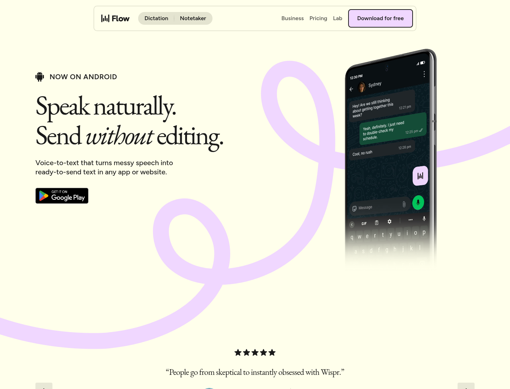
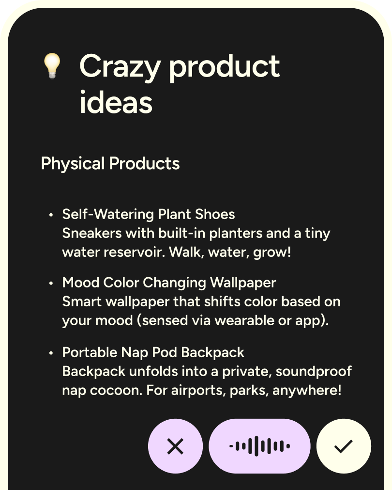

# Design reference study and visual evidence

Access/capture date: **2026-10-25**. Sources are public websites and the user's Handy screenshot. No competitor app was installed, logged into, or reverse engineered. Website captures are **not native Android device screenshots**. The original concept is a proposal, not an implementation. Downloaded reference images remain attributed study material; they are not licensed app artwork.

## Visual starting point

Observed: a light yellow/ivory website canvas, prominent dark serif heading, pale lavender gesture/ribbon artwork and a phone demonstration with a small contextual control. This is the Android **marketing site**. It does not prove background microphone eligibility or reveal the implementation of the floating control. Source: [Wispr Android](https://wisprflow.ai/android).

Observed in this published artwork: a dark note surface with large separate cancel, level-feedback and confirm controls. It is product artwork, not a screenshot captured from our own phone or proof that every state works that way. Source asset discovered on the [same official Android page](https://wisprflow.ai/android).

Observed: Downloaded Models, Available to Download, one Active state, several Recommended states, model descriptions, languages/capability metadata, file size and Delete/Download controls. The layout is dense and desktop-oriented. Pink speed/accuracy bars are visible but their metric/hardware is not established by the screenshot.

## Reference ledger: observed versus proposed

| ID | Primary source | Inspected evidence | Take / adapt for our Android app | Avoid / limitation |
|---|---|---|---|---|
| R1 | [Wispr Flow Android](https://wisprflow.ai/android) | Full-page/hero captures, official artwork, extracted branding + image inventory | Contextual mic entry, strong distinction between speaking and completion, show the experience in a real writing context | Do not copy brand/logo/ribbon/palette/marketing serif. Do not promise rewritten or universally insertable text |
| R2 | [Wispr Android setup](https://docs.wisprflow.ai/articles/8858845757) | Official written setup flow | Practice dictation, explain overlay/accessibility purpose, repair missing capabilities, teach manual paste fallback | Account login and data-sharing defaults are not our product choices. No authenticated in-app onboarding screenshots were captured |
| R3 | User-supplied Handy screenshot + [Handy repository](https://github.com/cjpais/Handy/tree/f81e7e70fb837a2d24db96ad69abc7969762876a) | Actual supplied model-library image; previous source-level registry investigation | Downloaded/available separation; exactly one active model; readable description/languages/storage | Don't reproduce speed/accuracy bars without matched phone evidence; no “works on any hardware” claim; model catalog isn't Android support |
| R4 | [Willow Voice](https://willowvoice.com/) | Full-page capture, extracted branding/image inventory, public content | Readable light base, generous whitespace, short action steps and clear hierarchy | Its marketing gradients/claims/testimonials are not app UI requirements. [Download page](https://willowvoice.com/download) lists Android as coming soon at access time; iPhone UI is not Android API evidence |
| R5 | [Superwhisper](https://superwhisper.com/) | Public full-page capture and branding/image inventory | Compact recording affordances, progressive advanced configuration and product demonstrations | Capture contains large empty/dark dynamic regions; absence there is not proof of missing features. Don't invent exact authenticated settings layouts or import cloud/rewriting features |
| R6 | [FUTO Voice Input](https://voiceinput.futo.org/) | Full-page capture and official local-processing explanation | Plain language about on-device behavior; direct explanation of the core voice-input function | Its dark website styling isn't our light-first direction. Published artwork is not a captured native interaction; no source-code reuse/licensing assumption |
| R7 | [Android Material 3 Compose](https://developer.android.com/develop/ui/compose/designsystems/material3), [adaptive UI](https://developer.android.com/develop/ui/compose/layouts/adaptive), [accessibility](https://developer.android.com/develop/ui/compose/accessibility), [insets](https://developer.android.com/develop/ui/compose/system/insets) | Official documents retrieved via Agent Reach/Jina | Native components, color/type roles, adaptive navigation, semantics, font/inset support | A web mockup cannot verify predictive Back, TalkBack, foreground-service notifications or 48 dp device rendering |

These are references, not endorsements or comparative product testing. Claims such as Willow's advertised time savings and model benchmark numbers on competitor pages were not adopted as our metrics.

## Extracted website styling — source observations only

Firecrawl's branding output is a heuristic extraction, not a manual CSS audit. Keep its confidence/scope separate from our deliberately chosen tokens. The raw evidence is in `../../work/design-research/*-brand.json` and `*-visual.json`.

| Site | Extracted typography | Extracted web color examples | Confidence / applicability |
|---|---|---|---|
| Wispr Android | Figtree body, EB Garamond headings; h1 around 76 px in this scrape | Background `#FFFFEB`; text `#1A1A1A`; primary web button `#F0D7FF` | Overall extraction ~0.80, color confidence ~0.64. Screenshot corroborates broad character. Values describe website, not native app |
| Willow | ABC Oracle detected for headings/paragraphs | White background; text `#25221D`; violet `#463FA6`, coral `#F55D48` among detected colors | Overall extraction ~0.72. Raw button sample can reflect an incidental element rather than main CTA. Do not bundle commercial font or infer whole app system |
| Superwhisper | Inter detected | Black background, near-white `#FAFAFA`; other sampled colors include dark decorative values | Overall extraction ~0.80. Screenshot has large dark regions and dynamic content; no reliable complete native palette was derived |
| FUTO Voice Input | Fira Sans detected | Dark `#0A0E14`, white foreground, blue `#0078D4` | This is web landing-page styling; screenshot supports broad appearance. Not proposed as our app theme |

Font families detected on third-party sites are reference observations. The app uses Android system typography and Devanagari fallbacks; it does not download these fonts. Exact button radius, animation and interaction values are not inferred where a static screenshot cannot establish them. Our 150–250 ms transitions and token hex values are original proposals, not measured competitor values.

## Local visual inventory

| File | Type / interpretation |
|---|---|
| [Wispr readable hero](references/wispr-website-hero.png) | Official Android webpage first viewport, 1440×1100 browser capture |
| [Wispr full page](references/wispr-website-full.png) | Full public landing-page browser capture; tall reference |
| [Wispr recording artwork](references/wispr-android-top.png) | Official published note/recording illustration; visible controls |
| [Wispr use-case illustration](references/wispr-android-product.png) | Official walking-character artwork; mood/reference only, not reusable app asset |
| [Handy supplied model library](references/handy-user-supplied-model-library.png) | User attachment preserved locally; desktop reference |
| [Willow full page](references/willow-website-full.png) | Public website browser capture; spacious light product composition |
| [Superwhisper full page](references/superwhisper-website-full.png) | Public browser capture; dynamic/empty regions explicitly not treated as complete UI inventory |
| [FUTO full page](references/futo-website-full.png) | Public browser capture; clear Android local-processing positioning |
| [Our original light concept](concepts/light-first-concept.png) | AI-generated three-screen proposal, not a competitor screenshot or device test |
| [Reference manifest](references/manifest.json) | Source URLs, capture date, hash and asset classification |

## Design synthesis

The useful common pattern is **quiet entry → unmistakable recording state → clear completion/recovery**. The app should spend its visual attention on readiness, actual listening state and preservation of user text. Marketing pages can be expressive; this operating surface needs native predictability.

The proposed light system uses an off-white neutral with deep-teal actions. It avoids Wispr's characteristic ivory/lavender/serif/ribbon combination, Handy's dense pink desktop catalog, and a pasted dark SaaS layout. Model choices are presented by language/device suitability with one clear active choice. Advanced artifact/runtime information is available in details, not scattered through onboarding.

The [original concept](../../DESIGN.md) deliberately adds the visible recording activity required by our engineering baseline. This differs from the pure-overlay impression of competitor marketing. Model load, VAD, transcription and insertion each have different feedback: an animated recording meter must not appear while no audio is being captured.

### Alternatives considered

1. Editorial ivory/lavender with a display serif: too close to Wispr's recognizable web identity, weaker for dense bilingual Android controls.
2. Dark desktop console: matches Handy's supplied catalog but contradicts the user's confirmed light-first preference and adds too much metadata to the everyday task.
3. Expressive purple/pink or animated waveform dashboard: puts visual emphasis on decoration and unmeasured rankings instead of capture status and text safety.
4. **Quiet native light workspace:** proposed direction. Clear status grouping, restrained teal, native navigation/controls and progressive model details. Its familiarity is intentional for an everyday Android utility; identity comes from coherent type, spacing and microphone-state treatment.

Impeccable's concept exploration was used as a check on direction (seed recorded in `work/design-research/`). No visual design was claimed approved based on a tool's assignment; the user's light-first preference and Android operating constraints govern. Do not introduce an elaborate decorative metaphor into permission or recording controls.

## Methods and limitations

Used Agent Reach's Exa discovery/Jina page reading first. Exa later reported a free MCP rate limit; known official URLs remained readable through Jina. Rendered screenshot and branding extraction used the Firecrawl design-extraction skill because those outputs are outside Agent Reach's documented page-reading capabilities. Native Android guidance came from Impeccable plus official Android documents; Frontend Design informed visual restraint and typography; Imagegen supplied the clearly labeled original concept.

All third-party assets remain their owners' work. They are stored as attributed references, excluded from any future APK resource folders, and must not become app logos, illustrations or shipped screenshots. Generated concept art is not production layout code; validate the actual native UI with device screenshots when implementation exists. No device benchmark, accessibility automation, app-store review or native screenshot capture was performed here.
