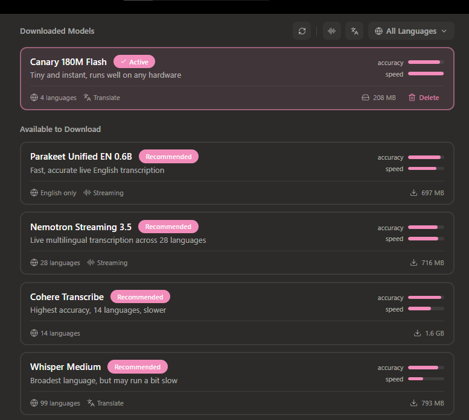

# Which models will this Android app use?

Updated 2026-10-25 after reviewing the user's Handy screenshot. This is the proposed release catalog, not a claim that models are already installed or phone-benchmarked. See [full model research](MODEL_COMPARISON.md) and [system architecture](SYSTEM_ARCHITECTURE.md).

## The practical answer

The app will have a model library, with several local model choices and independent engine adapters. **It will not download Handy's entire desktop catalog.** Start with the following four user-facing choices, staged across development:

| Choice in the app | Actual engine / artifact | Purpose | Verified model download | Release status |
|---|---|---|---|---|
| Whisper Base | whisper.cpp; multilingual `ggml-base-q5_1.bin` | Default English/Hindi/Hinglish candidate; balanced starting point | 59,707,625 B ≈59.7 MB | First proof of concept and cross-app MVP |
| Whisper Tiny | whisper.cpp; multilingual `ggml-tiny-q5_1.bin` | Smaller download; lower-resource alternative; quality must be compared | 32,152,673 B ≈32.2 MB | Optional model after download/switch UI exists |
| Whisper Small | whisper.cpp; multilingual `ggml-small-q5_1.bin` | Optional higher-capacity quality candidate; requires phone resource/quality evidence | 190,085,487 B ≈190.1 MB | Gated optional tier; proposed 6+ GB phone recommendation until measured |
| Moonshine Tiny Streaming | Moonshine Voice; English `tiny-streaming-en/quantized_26_08_21` ORT set | Distinct English-only streaming engine; potential quick dictation option | Required eight components 45,233,659 B ≈45.2 MB | Phase 3 second engine, after artifact/API/16 KB/device gates |

Download **only Base by default after the user chooses it**, plus 885,098 B of Silero VAD data. The combined model assets are 60,592,723 B ≈60.6 MB, excluding the app/native runtime download. Tiny/Small/Moonshine are optional downloads, not bundled first-run requirements. “Default” means recommended, not silently downloaded without consent.

Whisper Tiny/Base/Small are three sizes within one model family, using the same ASR runtime. Moonshine is a second, genuinely different ASR backend. **Silero is VAD, not another transcription model.** No language-ID model or AI rewrite model is required. The UI shows friendly names; details expose quantization, exact file format, revision, license and measured device results if available.

Hindi being supported by a multilingual model does not establish good Hinglish accuracy or reliable mixed-script output. All four performance/quality positions are proposed until physical testing. Moonshine's selected English artifact is never a Hindi/Hinglish fallback. There is no hidden paid/cloud fallback.

Sources for these assets and Android paths: [whisper.cpp Android sample](https://github.com/ggml-org/whisper.cpp/tree/231638a0717b7822784297e5980965ffcec05810/examples/whisper.android), [pinned Whisper files](https://huggingface.co/ggerganov/whisper.cpp/tree/5359861c739e955e79d9a303bcbc70fb988958b1), [Moonshine Android binding](https://github.com/moonshine-ai/moonshine/blob/234f60faa0eb388b01cdf7e60aca232af37aefda/language-bindings/android/java/main/java/ai/moonshine/voice/Transcriber.java), [Moonshine component metadata](https://github.com/moonshine-ai/moonshine/blob/234f60faa0eb388b01cdf7e60aca232af37aefda/core/moonshine-model-file-metadata.generated.cpp), [Silero artifact](https://huggingface.co/ggml-org/whisper-vad/tree/9ffd54a1e1ee413ddf265af9913beaf518d1639b).

## What about the models in the Handy screenshot?

This screenshot is evidence of the visible desktop catalog, not Android performance. Its speed/accuracy bars have no device/dataset context in the image. We will not copy those bars as if they were our measurements.

| Screenshot entry | What the inspected sources establish | Android-app decision |
|---|---|---|
| Canary 180M Flash | ASR/translation in English, German, French and Spanish; no Hindi. Original weights CC-BY-4.0. Handy's Q8 artifact is 218,447,648 bytes (~208.3 MiB) | Possible later non-Hindi candidate; do not make it the Hindi default. Its desktop “runs well on any hardware” wording is not an Android guarantee |
| Parakeet Unified EN 0.6B | English-only streaming variant; Handy catalog Q8_0 731,357,568 bytes, Q4_K_M 477,274,496 bytes; catalog says CC-BY-4.0, with original-artifact review still required before redistribution | Experimental later; no Hindi; exact Android NDK/JNI integration and phone profile needed |
| Nemotron Streaming 3.5 | Exact upstream `nvidia/nemotron-3.5-asr-streaming-0.6b` includes **Hindi hi-IN**, with 32 supported language-locales across two coverage tiers at the inspected source revision; weight license OpenMDW-1.1 | A meaningful **later Hindi-capable streaming candidate**, not rejected as English-only. Its heavier assets, runtime port/packaging, code-switch behavior and model terms need evaluation. Q4_K_M 495,831,520 B; Q8_0 751,094,240 B in Handy's pinned catalog |
| Cohere Transcribe | transcribe.cpp's inspected documentation identifies the 03-2026 family as 14 languages, excluding Hindi; describes Apache-2.0 weights. Q4_K_M 1,558,162,944 B in catalog. Original model-card request returned HTTP 401 in this pass | Exclude initial release: large footprint, no established Hindi path, original artifact/card/terms need access before shipping. Do not present the mirrored license description as a completed original-weight audit |
| Whisper Medium | Multilingual Hindi/English model, substantially larger than Base/Small; Handy uses a GGUF variant through transcribe.cpp | Later high-end option only after resource/quality results justify it. A Handy GGUF file does not load directly in the selected whisper.cpp adapter |

Sources: [Canary original card](https://huggingface.co/nvidia/canary-180m-flash/blob/b12ab41/README.md), [Nemotron original card](https://huggingface.co/nvidia/nemotron-3.5-asr-streaming-0.6b/blob/24b151a/README.md), [Nemotron integration notes](https://github.com/handy-computer/transcribe.cpp/blob/8facde6fcd8fb9caa585a5788ab450df6e8ec7db/docs/models/nemotron-3.5-asr-streaming-0.6b.md), [Cohere integration notes](https://github.com/handy-computer/transcribe.cpp/blob/8facde6fcd8fb9caa585a5788ab450df6e8ec7db/docs/models/cohere-transcribe-03-2026.md), [Handy exact catalog](https://github.com/cjpais/Handy/blob/f81e7e70fb837a2d24db96ad69abc7969762876a/src-tauri/src/catalog/catalog.json). Accessed 2026-10-25.

Names are not enough: Nemotron 3.5 is different from older English-only Nemotron Speech models; Parakeet v2, v3 and Unified EN differ too. Language-locales are not the same as unique languages, and the screenshot's count may differ by catalog revision. Do not infer coverage from a family label.

The screenshot labels some binary-size values MB. Our UI uses decimal MB/GB consistently, derived from exact bytes; details may also show MiB. Different quantizations/revisions and units explain why a similarly named artifact can have a different displayed size. Compare exact files, not just model names.

## How “many more models” will work

The library is extensible, rather than locked to these four choices. New models enter through a release gate:

1. Confirm an Android runtime/adapter and artifact format, including ABI/minimum SDK and 16 KB libraries.
2. Verify original model terms, commercial use and redistribution separately from runtime code licenses; pin provenance and SHA-256.
3. Run English/Hindi/Hinglish panels as relevant, including quantization and script behavior, on physical phones.
4. Measure peak PSS, load/record/stop latency, energy, thermals, cancellation and repeated-session stability.
5. Publish a supported-model/device tier, then add a downloadable entry to the reviewed registry.

Potential expansion: Nemotron 3.5 for Hindi streaming, Parakeet for English, Vosk Hindi as a low-resource comparator, and sherpa-onnx models with exact verified language/weight terms. transcribe.cpp could unlock several Handy families behind one adapter **if** its Android integration succeeds; there is no promise that the desktop adapter already works on phones.

Show only supported, distributable models in the normal Download library. A separately labeled research section may describe candidates, but does not offer working download/use buttons until the gates pass. Advanced details are optional; the everyday user sees language, suitability, storage and state before file formats. See [design specification](../../DESIGN.md) and [screen contracts](../design/SCREEN_SPEC.md).
