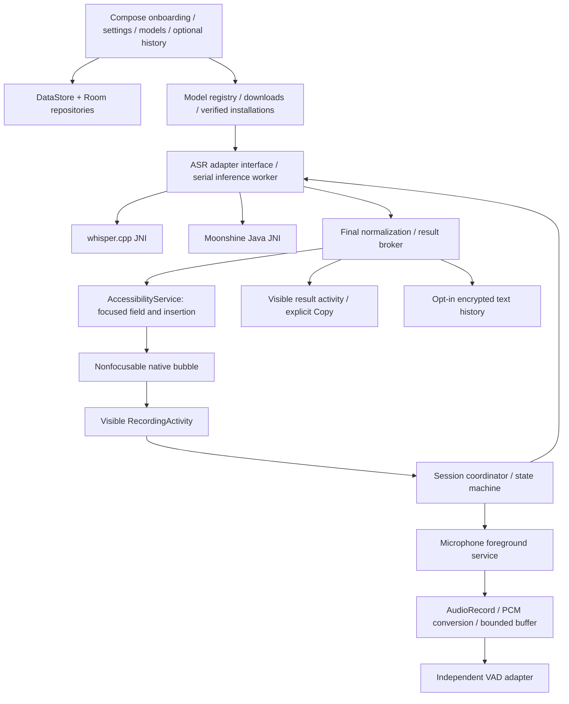
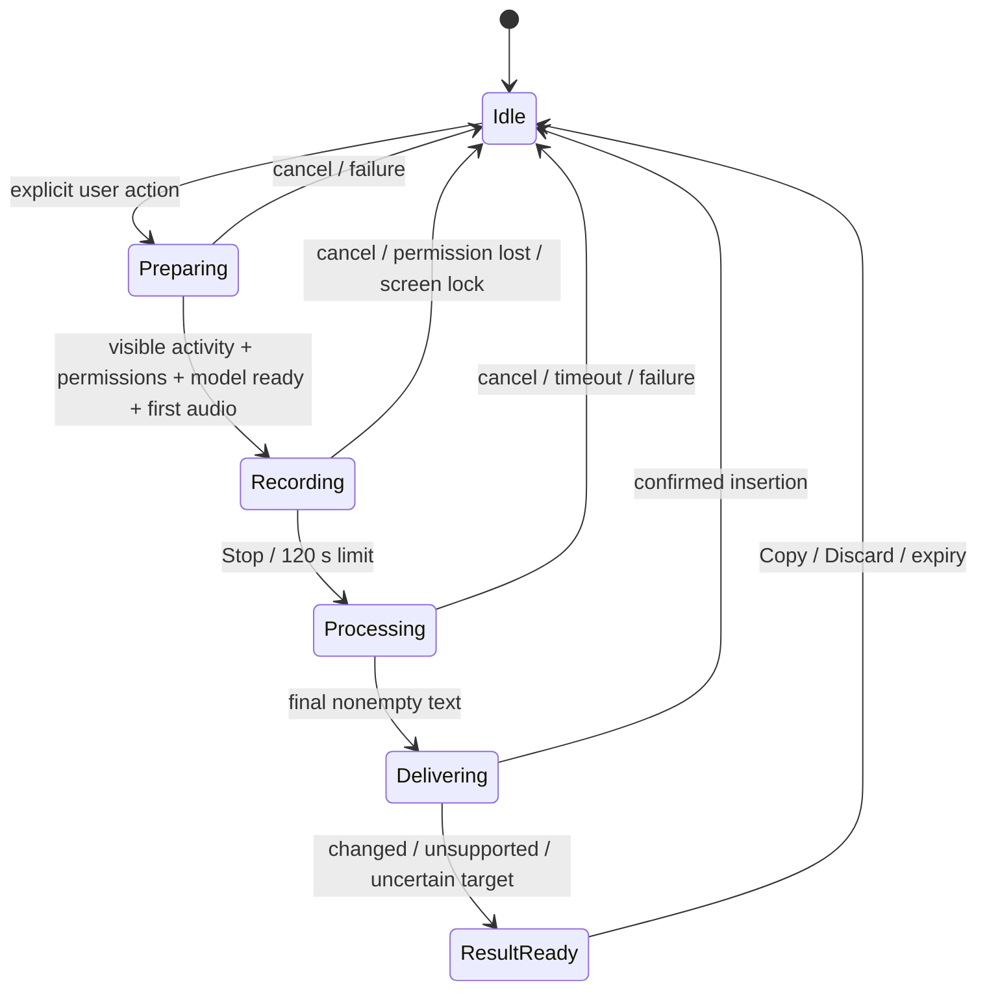

# Android system architecture

Status: proposed, 2026-10-25. This document defines contracts and behavior for future implementation; snippets are interface specifications, not product code. See [Research](TECHNICAL_RESEARCH.md) for source evidence and [Policies](ANDROID_PERMISSIONS_AND_POLICIES.md) for platform limits.

## Stack and module boundaries

Kotlin/Compose main UI and recording activity; Kotlin services, coroutines/StateFlow, AudioRecord, DataStore settings, Room metadata/history, OkHttp downloads, WorkManager resumable nonurgent work; CMake/NDK/JNI whisper.cpp CPU adapter and Silero VAD; Java/JNI Moonshine adapter in Phase 3. No server or account. No JS/Dart runtime or Rust layer. Select current mutually compatible stable toolchain versions and record locks when implementation starts; don't install toolchains during planning. Proposed `minSdk=26`, `targetSdk=36`, `compileSdk=37`; production `arm64-v8a`, emulator-only x86_64 where upstream supports it. All shipped native libraries must support 16 KB pages.

| Proposed Gradle module | Responsibilities |
|---|---|
| `:app` | Composition root; manifest components; navigation; DI; no engine-specific UI branches |
| `:feature:setup`, `:feature:settings`, `:feature:models`, `:feature:history` | Compose surfaces, disclosures, permission state and presentation |
| `:system:overlay`, `:system:accessibility` | WindowManager, focused-field tracking, target safety, insertion adapter; no ASR |
| `:core:audio`, `:core:asr-api`, `:core:vad-api`, `:core:session` | Capture/preprocess, contracts, state machine and orchestration |
| `:engine:whisper`, `:engine:moonshine`, `:engine:vad-silero` | Native/runtime-specific code, handle ownership, capability reporting |
| `:data:models`, `:data:settings`, `:data:history`, `:core:diagnostics` | Verified files/downloads, settings, optional history and redacted events |
| `:testing` | Reusable PCM fixtures, fake engines/targets, integration and benchmark harnesses |

Create only the modules needed for each phase, keeping the same dependency direction. Interfaces depend on Kotlin value types, not Activity, Room, Moonshine or whisper.cpp classes. Android audio/capture stays Android-specific. Small shared contracts/fixtures and C/C++ wrappers are future portability assets; do not introduce Kotlin Multiplatform before a second platform validates a need.

## Contracts before adapters

| Contract | Inputs / outputs and semantics |
|---|---|
| `AudioRecorder` | `start(SessionId, CaptureConfig)` produces owned PCM frames + actual route/format metadata; `stop()` drains already-read samples and closes hardware; `cancel()` discards all audio; one active capture globally |
| `AudioPreprocessor` | Device PCM -> mono 16 kHz normalized float `[-1,1]`, with sample-index continuity; no automatic gain that amplifies silence; resampler state belongs to one session |
| `VadEngine` | `open(model)`, `score(frame)->speech probability`, `reset()`, `close()`; frame/rate requirements declared; no recording or automatic ASR selection |
| `AsrEngineFactory` | Creates adapter by engine ID; returns supported artifact schema/ABI/runtime range; cannot download or record |
| `AsrEngine` | `load(InstalledModel, RuntimeOptions)->Capabilities`, `begin(SessionId, LanguageMode)->AsrSession`, `unload()`; serialized handle ownership |
| `AsrSession` | `accept(PcmFrame)` when streaming supported, `finish(PcmAudio)->FinalTranscript`, `events: Flow<Partial/Progress/Error>`, `cancel()`; final emitted at most once; late results discarded by session generation |
| `Capabilities` | Accepted sample rate/channels, languages, native streaming vs batch, optional language detection/timestamps, cancellation mode, maximum supported input; validated against loaded runtime |
| `ModelRepository` | Registry + installed states; `download`, `pause`, `resume`, `cancel`, `delete`, `verify`, `activate`; progress flow; never treats partial files as installed |
| `TargetTracker` | Produces short-lived `TargetToken(package, window, node identity hints, externalFocusGeneration, textDigest, selection)` on explicit start; digest is session-salted and memory-only; no persistent screen tree or screen contents |
| `TextInserter` | `insert(SessionId, TargetToken, finalText)->Inserted / Unsupported / TargetChanged / Uncertain / PermissionLost`; validates current focus and contents before a single action |
| `ResultBroker` | Holds final result in memory until insertion, Copy, Discard, or five-minute expiry; expiry visible; no raw audio; process death loses unsaved result |
| `HistoryRepository` | Adds text only if enabled at commit time; encrypted payload + timestamps/model/language; delete entry/all; no source app contents |

`SessionId` is an opaque random ID plus monotonic generation. `LanguageMode` is `English`, `Hindi`, or `MixedEnglishHindi`; engine auto-detection is an adapter strategy, not a promise to support every requested mode. Whisper mixed mode uses multilingual transcribe with automatic language evidence, never translate. User-selected Hindi is explicit; unsupported engine selection is an error, not silent English fallback.

`FinalTranscript` contains final text, model/artifact ID, selected mode, optional detected language, durations and warnings. Do not invent calibrated confidence if an engine lacks one. Partial text is provisional and rendered only inside an owned result surface; never insert partials into external apps in the MVP.

## Session state and lifecycle

The coordinator owns transitions under a mutex; StateFlow is the UI view of state. Reject duplicate starts, double-stop, stale permission callbacks, late native results, and model switches during an active session. Expose recoverable error values, not backend strings/stack traces, to users. Error paths close microphone first and invalidate the session before doing slower cleanup.

An enabled accessibility service owns the idle overlay. Do not keep an idle microphone FGS alive to protect the bubble. On bubble action, capture a target token and launch a **visible, nontransparent, compact RecordingActivity** using the granted system capability. It may take focus temporarily; this must be explained and tested. After it is resumed and permissions/model are ready, start the microphone FGS and `startForeground` immediately, then AudioRecord. If the activity launch is blocked, expose a notification action or in-app entry; no hidden repeated launch or recording attempt.

The FGS owns capture and a session-scoped partial wake lock only if profiling proves screen-awake CPU capture otherwise unreliable. Release on all exits. Stop/release AudioRecord and end the microphone FGS as soon as the user stops; inference runs while the recording activity remains visible. If that activity is backgrounded during processing, cancel rather than claiming durable background inference. During recording, the FGS may legally continue after activity backgrounding once started visibly; screen lock/off cancels by product policy. Notifications always provide Stop/Cancel and never transcript text. See the explicit lifecycle table in [Policies](ANDROID_PERMISSIONS_AND_POLICIES.md).

Model loading timeout: proposed 30 seconds; capture must not start first. Processing watchdog: `max(30 s, 2 × captured duration)`, capped at 240 seconds. Timeout stops delivery and attempts native cancellation. For Whisper wire the native abort callback to an atomic cancellation flag. For Moonshine, serialize calls and drop late results; do not close/free handles while native work is in flight. If cancellation cannot return in bounded time, quarantine the engine instance and block new sessions; show recovery, and gate release on fixing this limitation. Kotlin coroutine cancellation alone cannot stop JNI. No process killing for ordinary cancel. Android bound-service inference isolation is a future mitigation if native crash/hang results require it, not a desktop executable-spawning port.

After success/cancel/error, clear buffers and VAD state; do not promise cryptographic zeroization of every managed/native copy. Keep an idle ASR context for at most 60 seconds; unload earlier on Android memory pressure, permission loss, disable, or model switch. Keep only one loaded ASR model; VAD's small context is independent. No automatic recording resumption after restart.

## Audio pipeline and ownership

1. Use AudioRecord PCM16 mono at 16 kHz if the route supports it. Otherwise negotiate 48 kHz (or actual supported rate), record the negotiated rate, and apply a stateful anti-aliasing resampler to 16 kHz. A small independently implemented/polyphase resampler must have golden-fixture tests; a trivial sample dropper is unacceptable. If stereo input is unavoidable, downmix with clipping protection.
2. Capture thread writes timestamped/sample-indexed 20–30 ms frames to a bounded channel. It does no inference, disk/network IO or UI work. One coordinator-owned two-minute PCM16 buffer is authoritative; 120 s × 16,000 × 2 = 3,840,000 bytes (~3.66 MiB). A float copy is ~7.32 MiB; avoid repeated copies/IPC. Buffer overflow is an explicit failure, never silent missing speech.
3. Normalize only representation/clipping/DC handling as established by tests; keep actual speech volume characteristics. Meter RMS/peak with throttled UI updates, independent of VAD.
4. VAD scores 512-sample frames with proposed threshold 0.3. Preserve 450 ms before/after outer speech bounds and internal pauses. Do not drop every silence frame or stop on a 1.2 s pause. In the initial batch path process the bounded full utterance/outer crop through Whisper's own long-audio decoding. Streaming Moonshine accepts continuous frames and finalizes explicitly.
5. Very short/empty/digital-silence recordings return a NoSpeech result without insertion. Below 200 ms, explain “Recording was too short.” No-speech detection is conservative; quiet speech must not be discarded merely because its RMS is low. An empty result after cropping can retry once with the full retained PCM, provided cancellation/timeout has not occurred.
6. Postprocess conservatively: remove unsafe control characters, normalize newlines/outer whitespace; preserve Devanagari marks, spelling, punctuation, numbers, casing and internal code-switching. No filler removal or generated cleanup by default.
7. Delete raw buffers after final result/cancel/error. No audio persistence, crash upload, or history audio in the MVP. Process death loses the recording; explain this honestly.

Route change, audio focus loss, incoming call, microphone privacy toggle, or capture error closes capture and shows a clear interrupted-session result. Do not automatically reconnect Bluetooth and resume; let the user choose a new session. MVP supports built-in mic first; wired/Bluetooth input is a tested capability before being advertised. Bluetooth route management must follow current platform APIs and justified permissions, not assumed sample-rate equivalence.

## Safe external insertion

Listen to focused-view/window changes and narrowly filtered editable updates; debounce focus lookup (proposed 100 ms). Query the active focused node and minimal identity/eligibility metadata, not a broad background scan. Nonfocusable overlay uses `TYPE_APPLICATION_OVERLAY` and `FLAG_NOT_FOCUSABLE`, bounded touch region, and no transparent full-screen interception.

At the explicit recording start, read the eligible plain-text target and selection transiently, retain only a session-salted digest and selection with the target token, and discard the source text. If a reliable snapshot cannot be obtained, mark this session manual-copy-only. Track external focus changes separately: the expected move into our recording activity does not itself invalidate the token, but another external field/window, lock, or disconnection does.

After recording activity closes, wait at most two seconds for a stable eligible focus. Revalidate package/window/node hints and external focus generation against the initial target, then compare the current text digest and selection to the start snapshot. Changed content/selection uses fallback, even if it might have been a legitimate external edit. Do not insert into whichever field happens to be focused later. Keep the reacquired source text transient, and construct prefix + dictated text + suffix using valid UTF-16 indices. For a known selection replace that range; for a caret insert there. Do not add spacing blindly; apply deterministic adjacent-whitespace rules and test scripts/punctuation. If text/selection is unavailable, rich content is not faithfully represented, or composition is active/uncertain, use fallback. Accessibility offers no atomic compare-and-set: an external edit racing between the final check and action remains a residual risk, so recheck immediately before acting, verify after, and never auto-retry uncertain delivery.

`ACTION_SET_TEXT` sets the whole node value, not “type at cursor.” Only use it when a complete plain-text value/selection is known and safe. Prefer one action then verify expected value and selection where observable; set selection afterward where supported. Never use broad gestures or tap a target app's Send button. Do not automatically retry an uncertain insertion, which can duplicate text. An acknowledgement alone is not proof of insertion; return `Uncertain` and explain that the user should check before copying/pasting again.

Focus changes, external edits, clipboard conflicts, accessibility disconnect, password transformation, node reuse, multiwindow target changes or lock invalidate delivery. Repeated insertion requires a new explicit action. Accessibility does not grant a third-party InputConnection; an optional future IME is a separate product design.

## Model manager

`ModelDescriptor` fields: stable ID/version, engine ID/min runtime version, artifact-format schema, provider/display name/description, role, exact supported language modes, stream capability, quantization, ABI/min SDK, files (immutable URL/revision, exact bytes, SHA-256), uncompressed installed bytes if archived, RAM recommendation (labeled target/measurement), license code/weights links and attribution, and tier/recommendation rationale. Immutable descriptors are bundled with app releases. No mandatory online catalog or unsigned remote execution/configuration. Avoid arbitrary model import in MVP.

Install states: NotInstalled → Queued → Downloading → Paused/Verifying → Installed; failures retain a clear cause and safe resumable bytes when valid. Active and loaded are separate from installed. Use internal app-private `noBackupFilesDir/models/<id>/<version>/`; staging is adjacent `.part`/staging directory. Do not put required installed models in an evictable cache.

Downloads use unique per-model WorkManager jobs with optional unmetered constraint and exponential retry for transient network/5xx failures. WorkManager is not the recording/inference scheduler and does not defeat force-stop. Observe current long-running worker/FGS limits; for our sub-60 MB default, support deferral/resume rather than an indefinitely running dataSync job. Progress survives process death via metadata; user pause cancels transfer but preserves validated partials, Cancel removes partials, Delete removes installed files only after unloading. No automatic pause/resume claim without testing HTTP Range.

Require HTTPS and approved publisher/CDN locations, pin immutable identity and SHA-256, validate Range/Content-Range and stable object identity (ETag/If-Range where available), and restart if HTTP 200 ignores Range. Hash the completed file; incorrect length/hash deletes invalid staging. For model bundles verify each file and a complete manifest, constrain paths, forbid traversal/symlinks, limit extracted size, validate magic/schema and runtime compatibility, then atomically rename into place. Exact storage check: remaining network bytes + required staging/extracted bytes + 100 MiB reserve; check again before writes. All failures leave the existing installed version intact.

Version changes never overwrite a loaded artifact. Delete old versions only when no session/engine references them. Load smoke-test before activation; persist selection only on success. If the selected model fails, offer a compatible installed one, disclose the switch, and do not use English-only fallback for Hindi. No new download without user action. Missing models display model setup before mic opens.

## Data, diagnostics and security boundaries

Settings store language, selected model, overlay position/exclusions and consent versions. Room stores download/install metadata and, only when opted in, encrypted transcript payloads. Encrypt transcript text with AES-GCM using an Android Keystore key and unique nonce per record; keep keys out of backups and exclude history/model storage from automatic backup/device transfer. Metadata should not expose dictated text or source-field contents. Default retention after opt-in: seven days, user-selectable; delete-all removes records and rotates/removes keys, with no forensic-erasure claim.

Structured diagnostic events contain error category, durations, OS/ABI, selected model ID, state transition and byte counts. Never log PCM, transcript, node text, user-entered URLs, screen trees or clipboard content. Crash reporting is off by default; add only after a separate explicit diagnostics design. No analytics SDK required. Export a diagnostic summary only on user action, with preview and redaction.

Manifest components are nonexported except the required system-bound accessibility service protected by `BIND_ACCESSIBILITY_SERVICE`; PendingIntents immutable and app-scoped. File paths never become shell commands or executable code. HTTPS hashes do not establish a license; both are independent install/release checks. See [Policies](ANDROID_PERMISSIONS_AND_POLICIES.md) and [Risks](RISKS_AND_OPEN_QUESTIONS.md).
